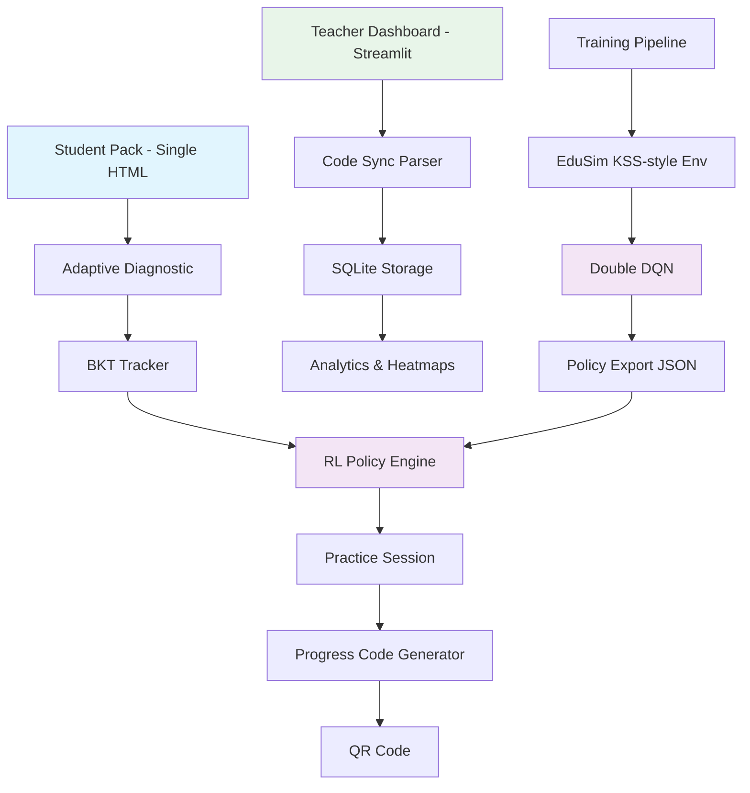

# SikshaSetu v2

[](https://www.python.org/downloads/)
[](LICENSE)
[](tests/)

> **An offline-first, RL-driven adaptive learning system for Class 6–8 Mathematics designed for students in regions with disrupted schooling (Manipur & North-East India).**

## Table of Contents

- [Overview](#overview)
- [Key Features](#key-features)
- [System Architecture](#system-architecture)
- [Mathematical Foundations](#mathematical-foundations)
- [Reinforcement Learning Pipeline](#reinforcement-learning-pipeline)
- [Progress Code Encoding](#progress-code-encoding)
- [Student Pack (Offline HTML)](#student-pack-offline-html)
- [Teacher Dashboard](#teacher-dashboard)
- [Installation](#installation)
- [Usage](#usage)
- [Testing](#testing)
- [Project Structure](#project-structure)
- [Credits & Attribution](#credits--attribution)
- [Limitations](#limitations)
- [License](#license)

## Overview

SikshaSetu v2 combines cognitive modeling (Bayesian Knowledge Tracing), prerequisite-aware knowledge graphs, and deep reinforcement learning to deliver personalized mathematics instruction. The system is **completely offline-capable** — students learn via a single self-contained HTML file, and teachers aggregate progress by pasting encoded progress codes into a local Streamlit dashboard. No central server, no internet dependency, no external APIs.

## Key Features

| Feature | Description |
| --- | --- |
| **Offline-First** | Entire student experience runs from `file://` with zero network calls at runtime |
| **Adaptive Diagnostic** | Information-theoretic question selection (maximum entropy) propagates evidence across the prerequisite graph |
| **Knowledge Graph** | Hand-crafted DAG of 30 Class 6–8 math concepts with validated acyclicity and prerequisite edges |
| **Bayesian Knowledge Tracing** | Per-concept mastery estimation with prerequisite-aware initialization and hint-aware updates |
| **RL-Driven Practice** | Double DQN policy selects `(concept, difficulty)` from a frontier-masked action space in real-time |
| **Bilingual Support** | English and Hindi content (Hindi translations flagged for native-speaker review) |
| **Progress Codes** | Compact base32-encoded mastery vector with CRC8 checksum, decodable in Python and JavaScript |
| **QR Integration** | Inlined QR generation for easy sharing without external libraries/CDN |
| **On-Device Personalization** | Student-specific learning speed/slip estimation and optional clipped last-layer TD updates |
| **Forgetting Simulation** | Realistic offline gaps (0–14 days) with exponential decay modeling |
| **Teacher Analytics** | Class heatmaps, prerequisite root-cause analysis, per-student trajectories, policy comparison lab |

## System Architecture



### Component Breakdown

| Module | Purpose | Implementation |
| --- | --- | --- |
| `core/knowledge_graph.py` | DAG validation, frontier computation, prerequisite/dependant traversal | NetworkX |
| `core/bkt.py` | Bayesian Knowledge Tracing with prerequisite-aware priors | Pure NumPy |
| `core/diagnostic.py` | Max-information question selection with graph propagation | Pure NumPy |
| `core/code.py` | Base32 encoding/decoding, CRC8, round-trip parity | Pure Python |
| `rl/env.py` | KSS-inspired gym environment with forgetting & hidden learner models | NumPy |
| `rl/train.py` | Double DQN with experience replay, target network, ε-greedy | Pure NumPy MLP |
| `rl/export_policy.py` | Weight serialization to compact JSON (<50KB) | JSON |
| `rl/evaluate.py` | Baseline comparisons with simulated learners | NumPy/Pandas |
| `packgen/build_pack.py` | Asset injection into self-contained HTML template | JSON templating |
| `dashboard/` | Multi-page Streamlit analytics suite | Streamlit/Plotly |

## Mathematical Foundations

### Bayesian Knowledge Tracing

Standard BKT maintains posterior probability of mastery $P(L_t)$ given observed responses.

**Update equations:**

$$
P(L_{t-1} \mid \text{correct}_t) = \frac{P(L_{t-1})(1-p_{slip})}{P(L_{t-1})(1-p_{slip}) + (1-P(L_{t-1}))p_{guess}}
$$

$$
P(L_{t-1} \mid \text{incorrect}_t) = \frac{P(L_{t-1})p_{slip}}{P(L_{t-1})p_{slip} + (1-P(L_{t-1}))(1-p_{guess})}
$$

$$
P(L_t) = P(L_{t-1}\mid obs_t) + (1 - P(L_{t-1}\mid obs_t))p_{transit}
$$

**Parameters:** $p_{init}$, $p_{transit}$, $p_{slip}$, $p_{guess$. Hint usage applies a multiplicative boost: $P(L_t) \leftarrow \min(0.99, P(L_t) \times 1.05)$.

**Prerequisite-aware initialization:**
$$
P(L_k^{(0)}) = \begin{cases}
0.10, & \text{if no prerequisites} \\
\max(0.05,\; \min_{j \in pred(k)} P(L_j^{(final\_prior)}) \times 0.30), & otherwise
\end{cases}
$$

Evidence propagates to prerequisites (+0.02 on correct) and dependants (-0.015 on incorrect) during diagnostic.

### Knowledge Graph Properties

- **Type:** Directed Acyclic Graph $G=(V,E)$ with $|V|=30$
- **Edges:** $u \to v$ means concept $u$ is a prerequisite of concept $v$
- **Validation:** `networkx.is_directed_acyclic_graph()` enforced in tests
- **Frontier:** $\{v \mid P(L_v)<0.9 \land \forall u \in pred(v): P(L_u)\ge0.6\}$

### Simulated Learner Model

Each synthetic learner $i$ has hidden parameters:

| Parameter | Distribution | Purpose |
| --- | --- | --- |
| $M^*_k \in (0,1)$ | $\text{Beta}(2,5)$ | Hidden true mastery per concept |
| $s_i \in (0.5,1.5)$ | $\text{Uniform}$ | Learning speed multiplier |
| $\pi_i \in (0.05,0.15)$ | $\text{Uniform}$ | Slip probability |
| $g_i \in (0.10,0.25)$ | $\text{Uniform}$ | Guess probability |
| $d_i \in \{0,\ldots,14\}$ | $\text{UniformDiscrete}$ | Days offline since last session |

**Forgetting during offline gaps:**
$$
M^*_k \leftarrow M^*_k (1 - 0.01\,d_i) + 0.01\,d_i \times 0.01,\quad M^*_k \in (0.01,0.99)
$$

**Response generation:**
$$
p_{correct}^{(obs)} = \text{clip}\!\left(\left(\hat{P}_k (1-\pi_i) + (1-\hat{P}_k)g_i\right)(0.8 + 0.2s_i),\ 0.05,\ 0.95\right)
$$
$$
t_{response} \sim \mathcal{N}\!\left(\frac{30}{s_i},\ 5\right)
$$

## Reinforcement Learning Pipeline

### State Space

State $s_t \in \mathbb{R}^{35}$ concatenates:

$$
s_t = \left[ \hat{P}(L_1),\ldots,\hat{P}(L_{30}),\;\ \bar{a}_{10},\;\ z_t,\;\ h_t,\;\ f_t,\;\ d_t/14 \right]
$$

| Component | Definition |
| --- | --- |
| $\hat{P}(L_k)$ | BKT mastery estimate for concept $k$ |
| $\bar{a}_{10}$ | EMA of accuracy over last 10 responses: $\alpha=0.3$ |
| $z_t$ | Response time z-score: $(\bar{t}_5 - 30)/10$, clipped to $[-2,2]$ |
| $h_t$ | Hint rate: $n_{hints}/n_{questions}$ |
| $f_t$ | Fatigue: $\min(1.0, n_{done}/20)$ |
| $d_t/14$ | Normalized days offline |

### Action Space

Actions are pairs $a_t = (c_t, \ell_t)$ where $c_t \in V$ (concept), $\ell_t \in \{1,2,3\}$ (difficulty).

**Masking constraints:**
1. $c_t$ in frontier: prerequisites mastered $\ge 0.6$, own mastery $< 0.9$
2. Or $c_t$ is a "forgotten" review target: $\hat{P}(L_{c_t}) < 0.5$ and $\hat{P}(L_{c_t}) < M^*_{c_t} - 0.1$
3. Fallback to any unmastered concept if frontier empty

Total possible actions: $30 \times 3 = 90$; valid subset varies by state.

### Reward Function

$$
R_t = 10 \cdot \Delta P(L_{c_t}) - 0.01 + B_t - P_t
$$

| Term | Value | Rationale |
| --- | --- | --- |
| Mastery gain | $10\Delta P$ | Primary signal from learning |
| Per-question cost | $-0.01$ | Encourages efficiency |
| ZPD bonus $B_t$ | $+0.10$ | If predicted $P(correct) \in [0.55, 0.80]$ (Vygotsky's Zone of Proximal Development) |
| Frustration penalty $P_t$ | $-0.20$ | If wrong streak $\ge 3$ consecutive errors |

### Double DQN Architecture

**Network:** 3-layer MLP with ReLU activations, pure NumPy

$$
h_1 = \text{ReLU}(W_1 s + b_1),\quad W_1 \in \mathbb{R}^{35\times 64}
$$

$$
h_2 = \text{ReLU}(W_2 h_1 + b_2),\quad W_2 \in \mathbb{R}^{64\times 64}
$$

$$
Q(s,a;\theta) = W_3 h_2 + b_3,\quad W_3 \in \mathbb{R}^{64\times 90}
$$

**Double DQN target:**

$$
y_i = \begin{cases}
r_i, & \text{terminal} \\
r_i + \gamma Q(s_{i+1}, \arg\max_a Q(s_{i+1},a;\theta);\theta^-), & otherwise
\end{cases}
$$

With $\gamma=0.99$, soft target updates ($\tau=0.01$), experience replay (capacity 10,000), ε-greedy ($\epsilon: 1.0 \to 0.01$, decay 0.995).

**Training:** 100 episodes default, 20 for `--quick`. Weights saved to `results/dqn_model.json`, exported to `packgen/policy.json` (rounded to 4 decimals, <50KB).

### On-Device Personalization (Student Pack)

The browser JS implements:
1. **Learning-speed estimation:** Updated after each answer based on response time relative to expected
2. **Slip estimation:** Bayesian update tracking error patterns
3. **Clipped last-layer TD update:** Behind feature flag (default ON), applies bounded gradient update to $W_3, b_3$ only with gradient clipping and divergence fallback to frozen policy

### Baseline Policies

| Baseline | Strategy |
| --- | --- |
| `random` | Uniform sample from valid actions |
| `fixed_curriculum` | Follow topological order of knowledge graph |
| `greedy_lowest_mastery` | Select unmastered concept with lowest $\hat{P}(L_k)$ |
| `bkt_only` | Maximize $(1-\hat{P}(L_k)) \cdot P(correct \mid k)$ among frontier |
| `rl_policy` | Double DQN with frontier masking (proposed) |

**Evaluation metrics** (over 200 simulated students × 5 seeds):
- Diagnostic MAE vs hidden mastery
- Questions needed for 80% mastery of gap concepts
- Mean mastery gain per 20 questions
- Retention after disruption gap

All results explicitly labeled **SIMULATED** in outputs.

## Progress Code Encoding

### Encoding Pipeline

1. **Quantize mastery:** For each of 30 concepts, $v_k = \text{round}(\text{clip}(m_k,0,1)\times 15) \in \{0,\ldots,15\}$ (4 bits)
2. **Pack bits:** 120 bits → 15 bytes (big-endian bit packing)
3. **Append metadata:** 4-byte student ID (ASCII) + 1-byte session number + 1-byte learner speed → 6 bytes
4. **CRC8:** `zlib.crc32(payload) & 0xFF` appended (1 byte)
5. **Base32 encode:** RFC 4648 alphabet `A-Z,2-7`, grouped in 4s with spaces
6. **Display:** Shown as `XXXX XXXX XXXX ...` with copy button, SMS share, and QR

### Decoding Pipeline

1. Base32 decode → bytes
2. Extract CRC, verify `zlib.crc32(payload) & 0xFF`
3. Parse 15 mastery bytes → 120 bits → 30 values of 4 bits → divide by 15
4. Parse 6-byte metadata
5. Return structured object with validation status

**Parity:** Identical algorithm implemented in Python (`core/code.py`) and JavaScript (inline in `packgen/template.html`). Round-trip tested with tolerance < 0.15.

## Student Pack (Offline HTML)

Single file `packgen/sikshasetu_pack.html` targeting **< 250 KB**.

### Screens

| Screen | Functionality |
| --- | --- |
| **Welcome** | Offline badge, EN/HI toggle, light/dark theme |
| **Diagnostic** | 8–10 max-information questions, progress bar, answer selection |
| **Gaps Results** | "Your gaps" with mastery bars |
| **Micro-Lessons** | Concept cards with EN/HI explanations |
| **Practice** | RL-driven questions, "Why this question?" (concept + reasoning), instant feedback, streak counter, mastery bars |
| **Session End** | Progress code (copy/SMS), inlined QR canvas, resume-safe state |

### Technical Features

- **Offline capable:** All assets inlined, no CDN, no external requests
- **file:// compatible:** Works when opened directly from disk
- **Mobile-first:** Optimized for 360px viewport, large touch targets (≥48px)
- **State persistence:** `localStorage` wrapped in try/catch for private/incognito/file contexts
- **Resume support:** Closed tab can resume session
- **Theme:** CSS custom properties for light/dark
- **i18n:** Runtime EN/HI toggle

## Teacher Dashboard

Multi-page Streamlit app (`dashboard/app.py`) with polished UI.

| Page | Features |
| --- | --- |
| **1. Overview** | KPIs, mastery trends, concept-wise performance |
| **2. Class Heatmap** | Plotly student×concept grid, top-3 shared gaps highlighted, prerequisite root-cause hints, grade filter |
| **3. Student View** | Mastery bars/radar, session trend, RL action log, suggested next steps |
| **4. Sync** | Paste single/multiple codes, CRC8 validation with friendly errors, SQLite roster, CSV/JSON export |
| **5. Pack Generator** | Student/generic, language, concept subset selection; build & download HTML; file size display |
| **6. RL Lab** | Training params, live reward curve, policy comparison, disruption-days slider, export `policy.json` |
| **7. Evaluation** | Run simulated experiments, interactive tables/charts, downloadable report (all labeled SIMULATED) |
| **8. Skill Pathway** | Cluster mastery detection → digital literacy/spreadsheet track recommendations |
| **9. Demo Mode** | One-click seed of 30 synthetic students for empty-state prevention |

**Storage:** Local SQLite (`sikshasetu.db`), all data stays on teacher's device.

## Installation

### Prerequisites

- Python 3.10+
- pip

### Setup

```bash
# Navigate to project
cd sikshasetu

# Install core dependencies
pip install numpy pandas networkx streamlit plotly pytest

# Clone/reference EduSim (included in external/)
# pip install -e external/EduSim  # may need gymnasium shim on modern Python
```

> **Note:** EduSim has legacy deps (gym, torch, longling). The implementation reuses KSS concepts with a clean NumPy fallback in `rl/env.py` and includes attribution + LICENSE reference.

## Usage

### Generate Data & Train

```bash
# Generate question bank from concepts
python scripts/gen_questions.py

# Train Double DQN (quick mode for testing)
python rl/train.py --quick

# Export policy for browser
python rl/export_policy.py
```

### Build Student Pack

```bash
python packgen/build_pack.py
# Output: packgen/sikshasetu_pack.html
```

### Run Teacher Dashboard

```bash
streamlit run dashboard/app.py
```

### Run Evaluations

```bash
# Run simulated baseline comparisons
python rl/evaluate.py

# Run additional experiments
python sim/experiments.py
```

### Using Makefile

```bash
make test    # Run all tests
make train   # Full training
make pack    # Build pack
make demo    # Generate questions → train → export → build pack
```

## Testing

```bash
PYTHONPATH=. python -m pytest tests/ -v
```

### Test Coverage

| Test | Validates |
| --- | --- |
| `test_graph.py` | DAG acyclicity, 30 concepts, prerequisite edges, frontier computation |
| `test_bkt.py` | BKT init/update, prerequisite-aware priors ordering |
| `test_code.py` | Base32 encode/decode round-trip, CRC8 checksum validation |
| `test_env.py` | Env reset/step, action masking, forgetting parameters |
| `test_questions.py` | 30 concepts covered, ≥8 questions each, EN+HI structure |

**All 12 tests passing.**

### Additional Validation

- JavaScript logic testable via Node.js
- Pack works from `file://` (airplane mode compatible)
- Code encoding parity between Python and JS

## Project Structure

```
sikshasetu/
├── Makefile
├── README.md
├── core/
│   ├── __init__.py
│   ├── bkt.py              # Bayesian Knowledge Tracing
│   ├── code.py             # Progress code encode/decode
│   ├── diagnostic.py       # Adaptive diagnostic
│   └── knowledge_graph.py  # Concept DAG
├── dashboard/
│   ├── app.py              # Main dashboard
│   └── pages/              # 9 sub-pages
├── data/
│   ├── concepts.json       # 30 concepts, prereqs, EN+HI
│   └── questions.json      # Generated question bank
├── external/
│   └── EduSim/             # Base repo (attributed)
├── packgen/
│   ├── build_pack.py       # Pack builder
│   ├── policy.json         # Exported RL weights
│   ├── sikshasetu_pack.html # Built pack
│   └── template.html       # HTML template
├── results/
│   ├── dqn_model.json
│   ├── evaluation_results.csv/json
│   ├── reward_curves.json
│   ├── sim_experiments.json
│   └── screenshots/
├── rl/
│   ├── env.py              # KSS-style environment
│   ├── evaluate.py         # Baseline evaluation
│   ├── export_policy.py    # Policy export
│   └── train.py            # Double DQN training
├── scripts/
│   └── gen_questions.py    # Question generator
├── sim/
│   └── experiments.py      # Simulation experiments
└── tests/
    ├── test_bkt.py
    ├── test_code.py
    ├── test_env.py
    ├── test_graph.py
    └── test_questions.py
```

## Credits & Attribution

| Source | Usage |
| --- | --- |
| **[EduSim](https://github.com/bigdata-ustc/EduSim)** (BigData Lab, USTC) | Inspiration for KSS-style prerequisite-dependent learning environment. See [paper](https://doi.org/10.1145/3292500.3330922): Liu et al., "Exploiting Cognitive Structure for Adaptive Learning", KDD 2019. |
| **BKT** | Corbett & Anderson (1994) knowledge tracing framework |
| **Double DQN** | Van Hasselt et al. (2016), Deep Reinforcement Learning with Double Q-Learning |
| **ZPD** | Vygotsky's Zone of Proximal Development concept applied to difficulty selection |

**EduSim License:** See `external/EduSim/` for original license terms.

## Limitations

| Limitation | Explanation |
| --- | --- |
| **Simulation-based evaluation** | All RL metrics use simulated learners, not real classroom data. Results are explicitly marked SIMULATED. |
| **Hindi content review** | Hindi translations need validation by native speakers for pedagogical accuracy. |
| **Simplified cognitive models** | BKT and learner simulators are simplified for browser compatibility and offline use. |
| **Classroom pilot needed** | System requires pilot testing in actual disrupted-schooling contexts (Manipur/North-East) before scale-up. |
| **Limited content scope** | Focused on Class 6–8 Mathematics only; no other subjects. |
| **No persistent cloud sync** | By design — progress codes enable teacher-mediated sync without central student database. |
| **Policy size tradeoff** | Weights rounded to 4 decimals to stay <50KB; full precision available in training artifacts. |

## License

This project is released for educational and research purposes. EduSim components retain their original licensing. See [LICENSE](LICENSE) for details.
